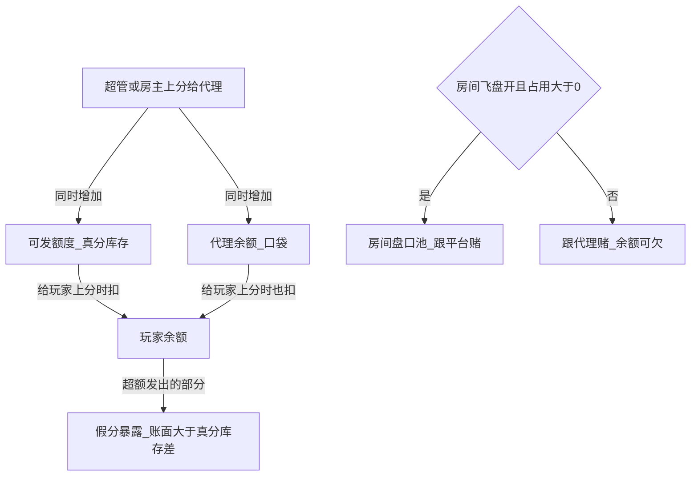

# 真分 / 假分 / 飞盘 · 人话说明

控制台「绑定代理」里四个数，不要混成一个「钱」。

## 四个数字

| 界面文案 | 字段 | 是什么 |
|----------|------|--------|
| **可发额度** | `pointsQuota` | 代理还能给玩家发多少**真分**。上分加，发给玩家减；关盘玩家输了会加回一点；飞盘下输掉一般不加回额度 |
| **飞盘占用** | `flyCover` | 已经发给玩家、还在桌上、算进飞盘暴露的量。发给玩家加；玩家输光/下分减；到 **0** 整房飞盘关 |
| **余额** | `balance` | 代理**自己口袋**。上分加，发给玩家减；关盘输赢、即时返水、月费走这里。**不是**玩家余额 |
| **已发** | `pointsUsed` | 历史净发出的真分累计，偏统计 |

## 假分

- 给玩家上分**可以超过**可发额度（业务允许超额）。  
- 超过真分库存的部分形成「假分」暴露（玩家余额仍加全额；库存只扣得动的真分）。  
- 假分不进上层飞盘返水口径的典型路径（以房间/玩家飞盘开关为准）。

## 玩家下注时谁涨谁扣

1. **先扣玩家余额**（下注本金）。  
2. **飞盘开**：输赢对手主要是**房间盘口池**；占用随飞盘盈亏规则变化。  
3. **飞盘关**：输赢对手是**代理账**；代理余额可变负，玩家仍可赢涨分。  
4. 代理「余额」**不会**因为玩家每下一注就实时跟着抖——除非关盘结算/返水/月费等规则触发入账。

## 和「平台佣金」报表的区别

房间概览里的佣金类数字是**多级挂靠分佣记账**，与飞盘「即时返水到代理额度」不是同一笔账。对账时分开看。
